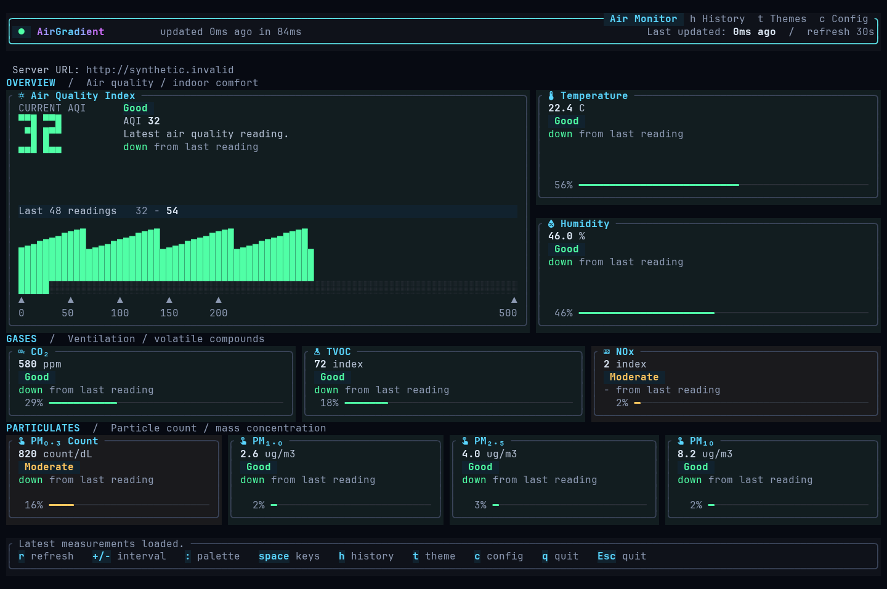
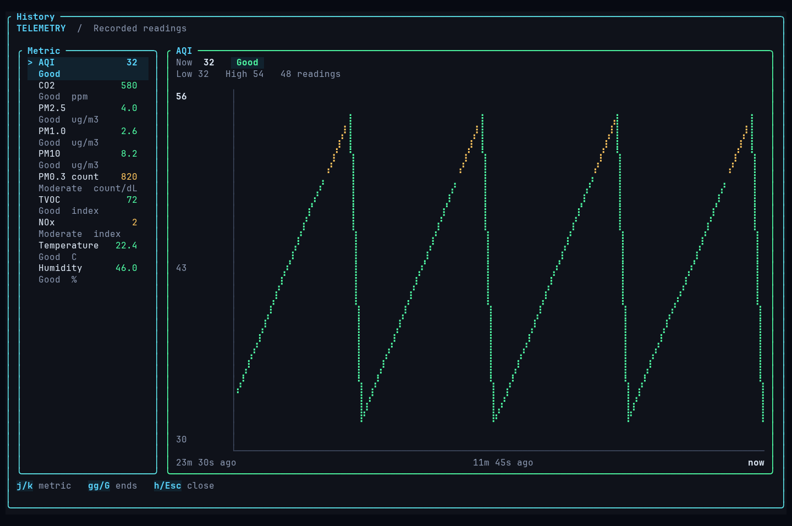

<div align="center">


# airgradient-cli

**Your air. Your terminal. No cloud account.**

Local AirGradient readings, a live dashboard, and JSON for scripts. Written in Rust.

[](https://github.com/worxbend/airgradient-cli/releases/latest)
[](https://github.com/worxbend/airgradient-cli/actions/workflows/ci.yml)
[](LICENSE)

[Website](https://worxbend.github.io/airgradient-cli/) · [Install](#install) · [Usage guide](docs/usage.md) · [v0.4.1 notes](docs/releases/v0.4.1.md)

</div>



*Actual Ratatui renderer, captured with synthetic demo data. Not live hardware readings.*

## Install

**Linux amd64 or arm64.** Download the installer, inspect it, then install v0.4.1:

```sh
curl --proto '=https' --tlsv1.2 -fsSL \
  https://github.com/worxbend/airgradient-cli/releases/download/v0.4.1/install.sh \
  -o install.sh
less install.sh
sh install.sh --version v0.4.1
```

The installer checks the archive's SHA256 checksum and installs to `~/.local/bin`.
If needed, it adds that path to `~/.bashrc` and `~/.zshrc`. Restart your shell afterward.
Archives are unsigned. No service or package-manager registration is installed.

Prefer the latest release, a custom directory, or a source build?
See [installation options](docs/usage.md#installation).

## Start here

You need an AirGradient monitor reachable on your LAN. Replace the example IP with your device's address.

```sh
# Save the address once.
airgradient-cli config set-url 192.168.1.201

# Read once.
airgradient-cli

# Open the live dashboard.
airgradient-cli --tui
```

Press **`q` to quit**. Press **`Space` for key hints**.
The dashboard refreshes every 30 seconds by default.

Nothing to configure yet? Try a device without saving its address:

```sh
airgradient-cli --tui --url 192.168.1.201
```

## What you get

- **One-shot readings.** AQI headline, metric table, status, and trend. Non-zero exit when a fetch fails.
- **Live dashboard.** Large AQI readout, metric cards, banded gauges, and sparklines.
- **Saved history.** Press `h` for charts. Readings survive restarts; the latest 2000 are retained.
- **JSON output.** Raw and formatted values, units, status, and trend for scripts.
- **20 themes.** Live preview, plus `mono` for terminals without a Nerd Font.
- **Quiet alerts.** TUI toasts for worsening air and recovery, not repeated warnings for an unchanged reading.
- **Shared settings.** Uses the desktop app's config. Preserves unknown JSON fields when updating settings.

Reads the device's `/measures/current` endpoint directly. No cloud service required.
Missing sensor values stay missing: `--` in text, `null` in JSON.

**New in v0.4.0:** redesigned dashboard and matching history, settings, theme picker, and command dialogs.
[Read the release notes](docs/releases/v0.4.0.md).

<details>
<summary><strong>See the history view</strong></summary>



*Actual renderer with synthetic demo data, not live hardware readings.*

</details>

## Commands worth knowing

```sh
# JSON for a script or jq.
airgradient-cli fetch --json

# Refresh every 10 seconds; use Nord for this session.
airgradient-cli --tui --refresh 10 --theme nord

# List themes, then save one.
airgradient-cli themes
airgradient-cli config set-theme nord

# Find or inspect your settings.
airgradient-cli config path
airgradient-cli config show
```

`--url`, `--refresh`, and `--theme` override this run; they do not save settings.
`--refresh` works only with `--tui` and accepts 5–3600 seconds.
Use `config set-refresh 10` to save an interval.

[All commands and flags](docs/usage.md#commands-and-flags)

## Dashboard keys

| Key | Action |
| --- | --- |
| `Space` | Show key hints |
| `r` | Refresh now |
| `h` | History chart |
| `t` / `F2` | Preview and choose a theme |
| `c` | Edit settings |
| `:` | Command palette |
| `q` / `Esc` / `Ctrl-c` | Quit from the dashboard |

Use `j`/`k` or arrow keys in lists. `Enter` applies; `Esc` cancels.
The history chart uses `j`/`k` to switch metrics.
[Full keyboard and mouse reference](docs/usage.md#keyboard-and-mouse)

## Keep it local

**Config:** shared with `airgradient-desktop` at
`$XDG_CONFIG_HOME/airgradient-desktop/config.json`, or `~/.config/airgradient-desktop/config.json`.
Use `--config <PATH>` for a separate file.

**History:** stored at `$XDG_DATA_HOME/airgradient-cli/history.jsonl`, or
`~/.local/share/airgradient-cli/history.jsonl`. Both one-shot reads and the dashboard record successful fetches.

Disable new history writes for a run:

```sh
AIRGRADIENT_CLI_NO_HISTORY=1 airgradient-cli --json
```

Existing history remains readable in the dashboard. This does not disable explicit config edits.
[Config rules](docs/usage.md#configuration) · [History format](docs/usage.md#history)

## If something looks wrong

- **Empty boxes instead of icons?** Run `airgradient-cli --tui --theme mono`, or use a [Nerd Font](https://www.nerdfonts.com/).
- **Device unreachable?** Check the saved address and LAN connection. Add `-v` for the error chain; `-vv` for trace detail.
- **Piping output?** Use `--json` or the one-shot table. The TUI needs an interactive terminal.
- **Small terminal?** Minimum dashboard size is 36×20. Lower metric rows may be clipped at that size.
- **Refresh failed?** The dashboard keeps the last successful reading and shows the error. It is not a fresh reading.

The v0.4.1 release was tested with synthetic fixtures, mock devices, and real pseudo-terminals.
**No live AirGradient hardware validation was performed for this release.**

## Go deeper

- [Usage guide](docs/usage.md): install options, flags, keys, config, history, alerts, and sensor parsing.
- [TUI design and preview gallery](docs/tui-design.md): renderer details and reproducible synthetic previews.
- [Screenshot capture](docs/screenshot-capture.md): regenerate the images with synthetic data.
- [Microsite design and browser checks](docs/site-design.md).
- [Code style](docs/code-style.md): contributor conventions.
- [Release checklist](docs/release-checklist.md) and [distribution boundary](docs/release-boundary.md).

<details>
<summary><strong>Maintainers: build, test, and release contract</strong></summary>

From a checkout, run the release gate in this order. Pins: **Rust 1.96.0**, **cargo-deny 0.19.9**.

```sh
cargo deny check
scripts/release-dry-run.sh --target x86_64-unknown-linux-gnu --output-dir dist
scripts/release-dry-run.sh --target aarch64-unknown-linux-gnu --output-dir dist-arm64
cargo fmt --check
cargo clippy --all-targets --all-features -- -D warnings
cargo test
```

Use a **new or empty** staging directory. The dry run is **validation-only**:
it does not tag, upload, sign, or publish. It rejects **every other target**, even with `--skip-build`.

Local dry-run outputs:

- `dist/airgradient-cli-v<version>-x86_64-unknown-linux-gnu.tar.gz`
- `dist-arm64/airgradient-cli-v<version>-aarch64-unknown-linux-gnu.tar.gz`
- `SHA256SUMS` in each output directory, covering its staged archive.

Each archive includes `airgradient-cli` and the checked-in `LICENSE`.
Published release assets use `linux-amd64` / `linux-arm64` filenames instead of target triples.
A matching `vX.Y.Z` tag triggers `.github/workflows/release.yml` to upload archives, checksums, and `install.sh`.
Artifacts are unsigned. `publish = false`: no crates.io package, package-manager recipe, or shell completions.
Only Linux binaries are published; there are no macOS or Windows release binaries.

After testing, record **PTY coverage**: real pseudo-terminal coverage exercised,
PTY unavailable and conditionally skipped, or infrastructure failure.
A green run with conditional PTY skips is not full terminal coverage.
Record real-device validation separately; explicitly waive it when hardware was not tested.

Keep tool pins synchronized across this README, `rust-toolchain.toml`, CI, and release notes.
Triage dependency-policy failures before release; do not hide vulnerabilities or broaden exceptions without review.
See the [detailed maintainer notes](docs/usage.md#development-and-release-policy) for policy and runtime-test boundaries.

</details>

---

[MIT license](LICENSE) · [worxbend/airgradient-cli](https://github.com/worxbend/airgradient-cli)
